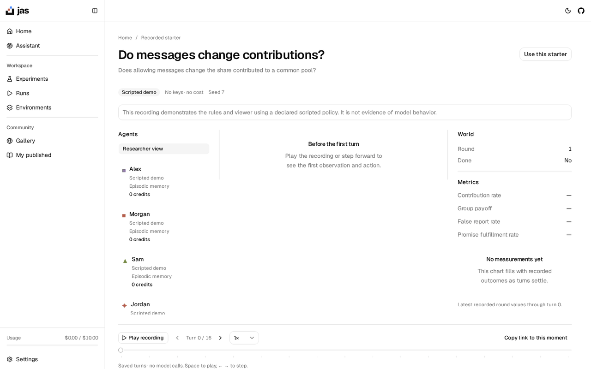

# JAS



Controlled, replayable experiments on AI agents. Compare conditions with the same
seeds, inspect what each agent saw, and share a record others can replay and fork.

Start a local workspace with a release wheel:

```sh
uvx --from ./jaslab-0.2.0-py3-none-any.whl jaslab
```

Python 3.13+ and [uv](https://docs.astral.sh/uv/) are required. The wheel includes
the interface and opens your browser at [localhost:8080](http://localhost:8080).
Registry publishing is pending; the intended release command is `uvx jaslab`.
To build a wheel or run from source, see [development](docs/DEVELOPMENT.md).
[Docker](docs/INSTALLATION.md#docker) is also supported.

Watch the recorded starters without a key. Add your own provider in Settings to
run models: OpenAI, Anthropic, OpenRouter, or an OpenAI-compatible/local endpoint.
Local use needs no account. Saving a protocol never runs it; paid actions show an
estimate and respect workspace and experiment limits.

[Publishing](docs/PUBLISHING.md) sends only reviewed experiment evidence to a
separate gallery. Provider keys and Assistant conversations stay local. Replay
checks recorded consequences with zero model calls; it does not establish that a
model would make the same choices again or that findings generalize to people.

[Docs](https://jas.mintlify.site) · [Install](docs/INSTALLATION.md) · [Guides](docs/README.md) ·
[Development](docs/DEVELOPMENT.md) · [Architecture](docs/ARCHITECTURE.md) ·
[MIT License](LICENSE)
